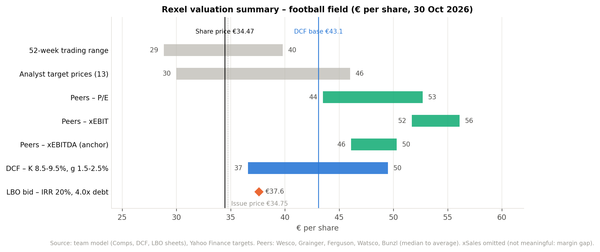
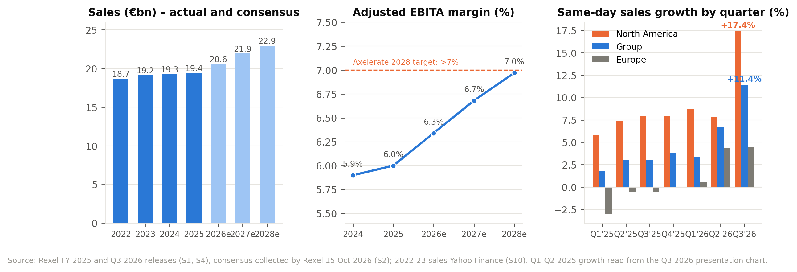
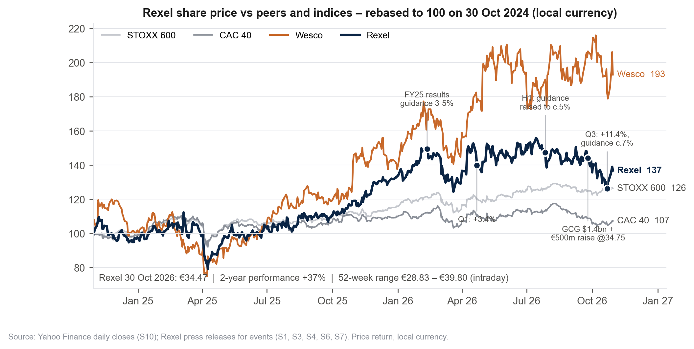
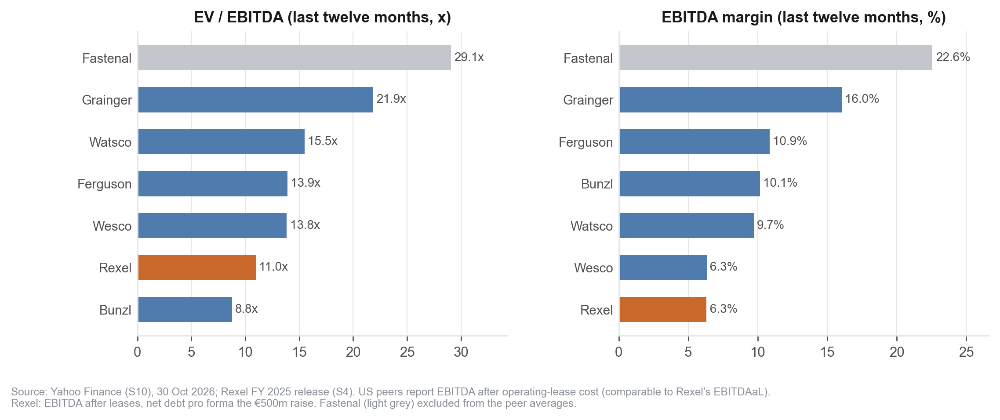
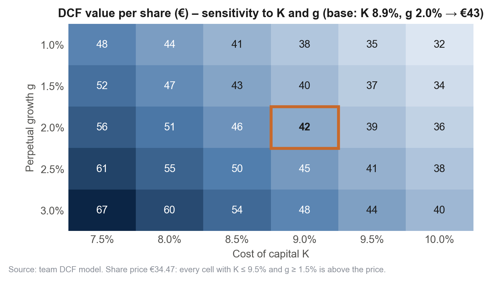

# Rexel (Euronext Paris: RXL) — Valuation of a listed company

**Should an investor acquire a stake in Rexel?**

Course project — *Introduction to Corporate Finance*, Université Paris Dauphine-PSL, Master 2 (104) Research in Finance, Prof. David Heller.
Authors: **Marwan Ferreira da Silva** and **Douae El Adloun**. Submitted 2 November 2026.

This repository holds the complete work behind the 15-slide presentation: the data and its sources, the Excel model (listed peers, DCF, LBO bid), the charts, and the scripts used to collect the data and check the model. The deliverable itself is `Rexel valuation - deck.pptx`; a PDF export sits next to it.

---

## 1. Summary of findings

| | |
|---|---|
| Valuation date | 30 October 2026 |
| Share price | €34.47 (52-week range €28.83 – €39.80) |
| Shares outstanding | 308.5 m, after the €500 m capital increase of 29 September 2026 at €34.75 |
| Market capitalisation | €10.6 bn |
| Net financial debt (pro forma, excl. leases) | €2.8 bn |
| Enterprise value | €13.5 bn, i.e. 9.8x 2026e EBITDA after leases |

| Method | Value per share | vs. €34.47 |
|---|---|---|
| Listed peers — xEBITDA, median to average | **€46 – 50** | +34 % to +46 % |
| Listed peers — xEBIT | €52 – 56 | |
| Listed peers — P/E | €43 – 53 | |
| DCF — base case (WACC 8.9 %, g 2.0 %) | **€43.1** | +25 % |
| DCF — sensitivity (K 8.5 – 9.5 %, g 1.5 – 2.5 %) | €37 – 50 | |
| LBO bid — 20 % IRR, 3-year hold, 4.0x acquisition debt | **€37.6** | +9 % |
| Sell-side (13 analysts) | €30 – 46, mean €41.9 | |

**Recommendation: Buy, target €43 – 46 per share** (DCF and peer multiples equally weighted: €45.8). Every method lands above the market price. Rexel reports its best operating momentum since 2022 (Q3 2026 same-day sales +11.4 %, 2026 guidance raised twice), yet trades at 9.8x 2026e EBITDA after leases against 13 – 14x for comparable US distributors. The gap is a listing and sentiment discount, widened by the overhang of the $1.4 bn GCG acquisition and the capital increase, rather than an operating one. A financial sponsor could pay at most a 9 % premium and still earn 20 %, so a leveraged buyout is marginal; the upside belongs to a long-term shareholder or a strategic buyer.



---

## 2. Methodology

The three methods follow the framework taught in the course and are implemented in one workbook, `Model/Rexel - Inputs & data pack.xlsx`. Blue cells are inputs taken from a cited source; black cells are formulas. Every input carries a source number (S1 – S15, listed in the workbook's `README` sheet and in section 5 below).

### 2.1 Listed peers (`Comps` sheet)

* **Sample.** Five listed B2B distributors with comparable business models: Wesco (electrical, the closest listed peer), Grainger (MRO), Ferguson and Watsco (plumbing and HVAC), Bunzl (consumables). Sonepar and Graybar, the two closest competitors, are private. Fastenal (29x EBITDA), Legrand and Schneider (manufacturers) are shown for reference but excluded from the averages.
* **Multiples.** EV = market capitalisation + net debt; xSales, xEBITDA, xEBIT and P/E on last-twelve-month and next-year figures; sector median and average applied to Rexel's aggregates; equity value = EV − net debt − minorities.
* **Accounting consistency.** US GAAP peers expense operating leases above EBITDA, so Rexel is valued on EBITDA after leases (EBITDAaL) and adjusted EBITA, with IFRS 16 lease liabilities excluded from net debt.
* **Reading.** xEBITDA is the anchor. The sales multiple (€77 – 95) is reported but not used: Rexel's 6 % EBITDA margin against 10 – 23 % for the peers makes it meaningless. P/E is distorted by leverage and tax differences.

### 2.2 Discounted cash flows (`DCF` sheet)

* **Business plan.** 2026 – 2028 from the broker consensus collected by Rexel itself (13 brokers, 5 – 13 October 2026, excluding GCG, collected before the 22 October guidance raise). 2029 – 2032: a "soft landing" where sales growth converges linearly to the perpetual rate, the EBITDAaL margin is frozen at the 2028 level, capex converges to depreciation and working capital stays at 14.2 % of sales (2025 financial balance sheet).
* **Free cash flow** = EBIT × (1 − t) + D&A − capex − ΔWCR, with EBIT = adjusted EBITA and t = 27 %.
* **Discount rate.** Risk-free rate 4.13 % (average of the 10-year Bund and US Treasury, Rexel being 51 % North American), market risk premium 5.0 % (Damodaran, France, January 2026), beta 1.20 (own two-year weekly regression against the CAC 40: 1.25; Yahoo Finance: 0.98), spread 150 bp (Ba1 / BB+), weights at market value → **WACC 8.87 %**, inside the 8.4 – 9.8 % range Rexel uses in its own impairment tests. The course's Modigliani–Miller chain (unlevered beta, unlevered cost of equity, re-levered cost of equity, adjusted cost of capital) is shown as a cross-check (K = 8.64 %).
* **Terminal value** by Gordon–Shapiro at g = 2.0 %; it represents 68 % of enterprise value. A live sensitivity table covers K from 7.5 % to 10 % and g from 1 % to 3 %.

### 2.3 LBO-style bid (`LBO` sheet)

* **Structure.** A holding company acquires 100 % of the equity at the end of 2026, financed by Senior A (amortising over 7 years), Senior B (bullet, 8 years), Junior C (bullet, 9 years) and sponsor equity. Acquisition debt is set at 4.0x 2026e EBITDAaL (€5.5 bn) on top of Rexel's existing 2.0x, i.e. 6.0x in total.
* **Mechanics.** Rexel's plan runs on the consensus and a soft landing; 100 % of net income is upstreamed as dividends; the holding deducts the acquisition interest from the group's taxable income (tax consolidation); cash accumulates after Senior A amortisation.
* **Bid.** The fund exits after three years at the entry multiple (10.3x EBIT) and requires a 20 % IRR. The bid is the maximum price at which that return is exactly met: fund equity (exit equity discounted at 20 %) plus the acquisition debt, divided by the number of shares: **€37.6**, a 9 % premium, 1.7x money multiple. Sensitivities cover the IRR (15 – 25 %), leverage (3.5 – 5.0x), the exit multiple (9 – 12x) and the holding period (3 or 5 years).

### 2.4 Verification

The workbook's formulas were evaluated with a spreadsheet engine outside Excel and reconciled to an independent re-implementation of the three models in Python (`scripts/06_independent_check.py`); the DCF reconciles to the euro, and the balance-sheet checks in the DCF and LBO sheets are zero. The deck's tables are computed from the same inputs.

---

## 3. Key charts

| | |
|---|---|
|  |  |
|  |  |

---

## 4. Limitations and judgement calls

* **Peer forward estimates.** Next-year EBITDA and EBIT for the peers are proxies (consensus revenue × last-twelve-month margin) because no free source publishes them; next-year net income uses consensus EPS. The median is used to limit sample bias.
* **GCG.** The $1.4 bn acquisition is expected to close by year-end 2026 and is not in the base-case cash flows; the net debt is pro forma for the capital increase only. The "including GCG" consensus columns are kept in the `Consensus` sheet for a pro-forma variant.
* **Risk-free rate.** French 10-year yields reached a 24-year high in October 2026 (4.97 %). A blended Bund / Treasury rate was preferred to the OAT given Rexel's geographic mix; using the OAT alone would lower the DCF by roughly €4 per share.
* **Interest in the LBO** is computed on opening net debt rather than the average, to avoid a circular reference; the difference is immaterial.
* **Historical figures for 2022 – 2023** come from Yahoo Finance; 2024 – 2026 figures come from Rexel's own releases and financial statements.

---

## 5. Sources

| # | Source | Date | Used for |
|---|---|---|---|
| S1 | Rexel, Q3 2026 sales press release and presentation | 22 Oct 2026 | Q3 and 9-month sales, growth split, backlog, guidance |
| S2 | Rexel, broker consensus collected before Q3 2026 (13 brokers) | 15 Oct 2026 | Business plan 2026e – 2028e |
| S3 | Rexel, Q2 sales and H1 2026 results | 27 Jul 2026 | H1 accounts, net debt at 30 June 2026 |
| S4 | Rexel, Q4 sales and FY 2025 results | 11 Feb 2026 | FY 2024 – 2025 accounts, working-capital ratios |
| S5 | Rexel, 2025 consolidated financial statements | 16 Feb 2026 | Balance sheet, segments, EPS, treasury shares, impairment-test WACC |
| S6 | Rexel, acquisition of GCG | 25 Sep 2026 | Deal terms and financing |
| S7 | Rexel, capital increase | 29 Sep 2026 | Share count, issue price |
| S8 | Rexel, debt and ratings page | 30 Oct 2026 | Ratings, bonds, gross debt |
| S9 | Rexel, shareholding structure | 31 Dec 2025 | Shareholders |
| S10 | Yahoo Finance | 30 Oct 2026 | Prices, peer financials, estimates, betas |
| S11 | Trading Economics | 30 Oct 2026 | Sovereign yields |
| S12 | Damodaran, country risk premiums | Jan 2026 | Equity risk premium |
| S13 | Sonepar, 2025 results | 2026 | Competitor scale |
| S14 | Electrical Wholesaling, 2026 Electrical Pyramid | 2026 | US market concentration |
| S15 | Course material, Parts 3 – 5 | 2026 | Methods |

The Rexel documents are stored in `Sources/`. Company logos used on the slides are the companies' trademarks, reproduced for academic illustration only.

---

## 6. Repository guide

```
├── Rexel valuation - deck.pptx            The presentation (15 slides); PDF export alongside
├── CHECKLIST - Rexel project.md           Assignment rules, method checklist, slide plan, working notes
├── Model/
│   ├── Rexel - Inputs & data pack.xlsx    README (sources) · Rexel_Hist · Consensus · Market · Peers · WACC_inputs · Prices · Comps · DCF · LBO · Summary
│   └── prices_daily_2021-2026.csv         Daily closes: Rexel, peers, CAC 40, STOXX 600
├── Charts/                                Charts used in the deck (PNG and vector PDF); Charts/logos/
├── Sources/                               Rexel public documents
└── scripts/                               Data collection, workbook build, charts, independent check, deck generator
```

### Reproducing the work

```bash
pip install -r scripts/requirements.txt
cd scripts
python 01_pull_prices.py             # prices and key statistics (Yahoo Finance)
python 02_pull_peer_financials.py    # peer financials, estimates, regression betas
python 03_build_inputs_workbook.py   # the sourced Inputs sheets
python 04_build_model_sheets.py      # Comps, DCF, LBO and Summary sheets (live Excel formulas)
python 05_charts.py                  # the five charts
python 06_independent_check.py       # recomputes the three models and prints the results
npm install pptxgenjs && NODE_PATH=./node_modules node 07_build_deck.js   # regenerates the deck
```

The workbook is saved without cached values and recalculates when opened in Excel.

*Academic work; not investment advice.*
## Presentation updates — 31 October 2026

The 15-slide Rexel valuation presentation has been reviewed and updated.

- **Slide 3 — Market overview:** Added Rexel's €320bn addressable market, qualitative growth outlook and end-market trends. Updated Graybar's 2025 revenue to $12.9bn.
- **Slide 4 — Competitive landscape:** Updated Graybar and Würth financial figures, checked Wesco's geographical footprint, and added Rexel's market positioning in France and the US.
- **Slide 5 — Company overview:** Added Rexel's corporate history and CEO Guillaume Texier's strategic repositioning. Reviewed Axelerate 2028 financial targets.
- **Slides 2, 14 and 15 — Investment recommendation:** Clarified that the €37.6 LBO valuation represents the maximum implied bid at a 20% target IRR, rather than a guaranteed share-price floor. Removed the unsupported 3:1 upside/downside ratio.

**Outstanding data limitations:** CED's approximately $8bn revenue remains an estimate; no reliable overall CAGR was identified for Rexel's €320bn addressable market.

All valuation outputs, financial models and investment recommendations remain unchanged.
